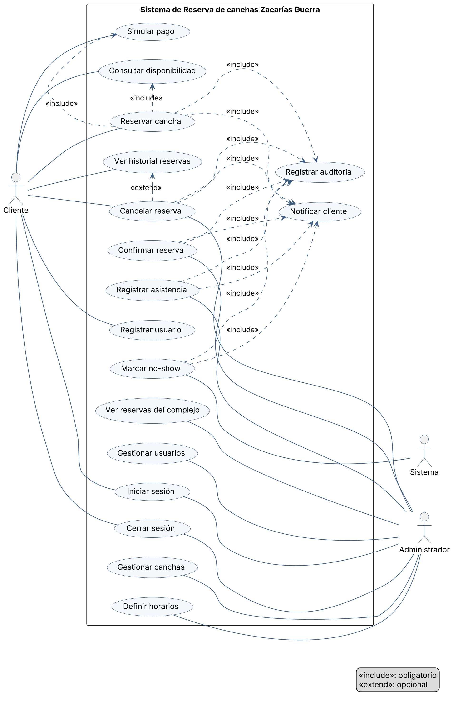
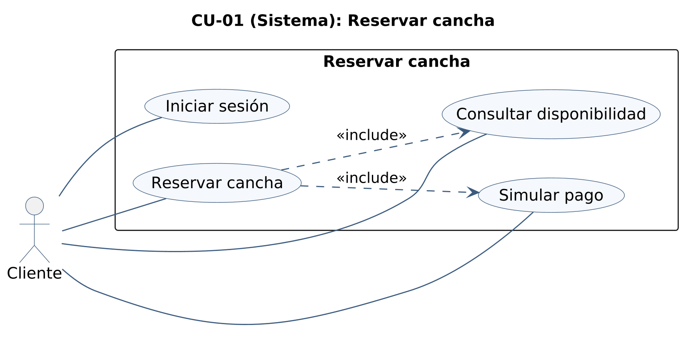
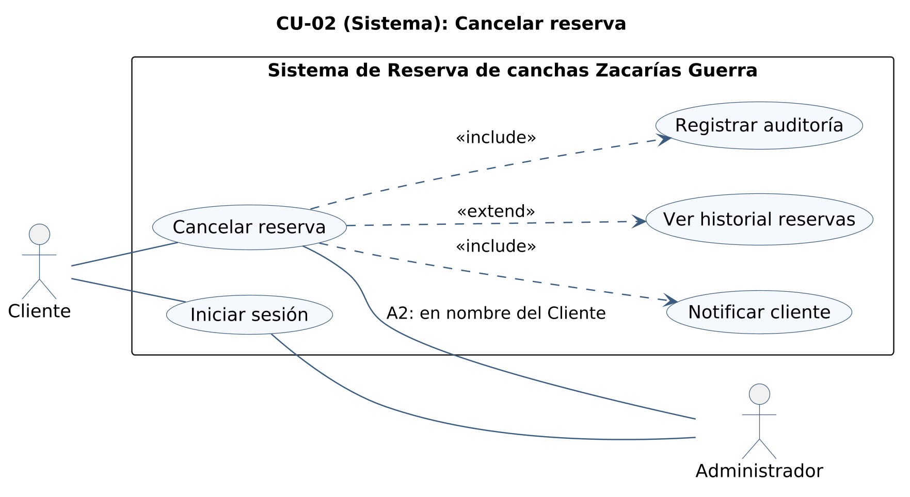

# Modelo de casos de uso

Diagrama general de casos de uso, ficha y diagrama de CU-01 y diagrama de CU-02, corregidos. Reemplazan a los del Entregable 1 (E1 Cap. I, Modelo de Casos de Uso) y aplican las correcciones de casos de uso de la sección 4.1 de `docs/trazabilidad.md` (filas MOD-CU-GEN, MOD-CU-01 y MOD-CU-02), y las ampliaciones 1 a 4 de la sección 4.2 en el diagrama general. Responde al issue #49.

Lo que no figura en las tablas de cambios se dibuja igual que en el Entregable 1.

## 1. Diagrama general

Fuente PlantUML: [`casos-de-uso.puml`](casos-de-uso.puml).

- **Actores:** Cliente, Administrador y Sistema. Sistema es el actor del no-show automático: nadie lo ejecuta, el sistema marca las reservas vencidas.
- **Casos de uso (17):** los 14 del Entregable 1 (Consultar disponibilidad, Reservar cancha, Simular pago, Ver historial reservas, Registrar usuario, Cancelar reserva, Confirmar reserva, Gestionar canchas, Definir horarios, Ver reservas del complejo, Iniciar sesión, Cerrar sesión, Gestionar usuarios y Notificar cliente), que son las filas CU-GEN-01 a CU-GEN-14 de la matriz, más Registrar asistencia, Marcar no-show y Registrar auditoría (ampliaciones de 4.2).
- **Relaciones:** Reservar cancha «include» Consultar disponibilidad y Simular pago; Cancelar reserva «extend» Ver historial reservas. Reservar cancha, Confirmar reserva, Cancelar reserva, Registrar asistencia y Marcar no-show «include» Notificar cliente y Registrar auditoría. «include» es obligatorio y «extend» es opcional.
- **Auditoría de la gestión:** Gestionar canchas, Definir horarios y Gestionar usuarios también registran auditoría (RF13). No se dibuja esa inclusión para no recargar el diagrama.

### Cambios respecto del Entregable 1

| Corrección de 4.1 | Fila de la matriz | En este diagrama |
| --- | --- | --- |
| Simular pago pasa de «extend» a «include» de Reservar cancha | CU-GEN-03 | Reservar cancha «include» Simular pago: el pago es obligatorio e inmediato |
| Quitar la asociación de Registrar usuario con el Administrador | CU-GEN-07.a | Registrar usuario solo se asocia con el Cliente: el registro público crea solo clientes |
| Ampliación 1: agregar Registrar asistencia (Administrador) | 4.2 | Caso nuevo asociado al Administrador |
| Ampliación 2: agregar el no-show automático | 4.2 | Caso Marcar no-show, asociado al actor Sistema |
| Ampliación 3: agregar Registrar auditoría, incluido por los cambios de estado | 4.2 | Caso nuevo, incluido por Reservar cancha, Confirmar reserva, Cancelar reserva, Registrar asistencia y Marcar no-show |
| Ampliación 4: Notificar cliente incluido por Reservar cancha | 4.2 | Reservar cancha «include» Notificar cliente. Por coherencia con el código, también lo incluyen Registrar asistencia y Marcar no-show: toda transición notifica al cliente |

## 2. CU-01 (Sistema): Reservar cancha

Fuente PlantUML: [`cu-01-reservar-cancha.puml`](cu-01-reservar-cancha.puml).

### Ficha

- **Actor principal:** Cliente.
- **Incluye:** Consultar disponibilidad (obligatorio).
- **Incluye:** Simular pago (obligatorio).
- **Precondición de acceso:** el Cliente debe haber iniciado sesión (asociación directa Cliente → Iniciar sesión).

**Descripción:** permite al Cliente, ya autenticado en el sistema, reservar una cancha disponible en la fecha y horario que elija.

**Precondiciones:**

1. El Cliente inició sesión correctamente.
2. Existen canchas dadas de alta en el sistema.

**Flujo básico:**

1. El Cliente selecciona la opción "Reservar cancha".
2. El sistema ejecuta el caso de uso incluido Consultar disponibilidad, mostrando las canchas libres según fecha/horario.
3. El Cliente selecciona cancha, fecha y horario disponibles.
4. El sistema ejecuta el caso de uso incluido Simular pago y registra la reserva con estado `PAGADA`.
5. El sistema muestra al Cliente la confirmación de la reserva.

**Flujos alternativos:**

- **A1, Sin disponibilidad:** el sistema no encuentra canchas libres en el horario pedido; ofrece horarios alternativos o permite que el Cliente cancele la operación.
- **A2, Sesión expirada:** si la sesión del Cliente expira antes de confirmar, el sistema lo redirige a Iniciar sesión y, tras autenticarse, retoma el flujo donde quedó.

**Postcondiciones:** la cancha deja de figurar como disponible para ese horario.

### Cambios respecto del Entregable 1

| Corrección de 4.1 | Fila de la matriz | En este diagrama |
| --- | --- | --- |
| Quitar el punto de extensión "si el Cliente elige pagar en línea" | CU-01.EXT | La ficha no tiene punto de extensión: el pago es parte del flujo básico |
| Paso 4: la reserva se registra en `PAGADA`, no en "Reservado" | CU-01.FB4 | Paso 4: el sistema ejecuta Simular pago y registra la reserva en `PAGADA` |
| Fuera de 4.1: el actor estaba rotulado «Actor» | MOD-CU-01 | El actor es el Cliente, como dice la ficha |
| Fuera de 4.1: el «include» de Simular pago iba de Simular pago hacia Reservar cancha | MOD-CU-01 | El «include» va de Reservar cancha hacia Simular pago, como el de Consultar disponibilidad |

## 3. CU-02 (Sistema): Cancelar reserva

Fuente PlantUML: [`cu-02-cancelar-reserva.puml`](cu-02-cancelar-reserva.puml).

La ficha de CU-02 no cambia: sigue siendo la del Entregable 1.

### Cambios respecto del Entregable 1

| Corrección de 4.1 | Fila de la matriz | En este diagrama |
| --- | --- | --- |
| El rótulo decía "CU-03: Cancelar reserva"; debe decir CU-02 | MOD-CU-02 | Título «CU-02 (Sistema): Cancelar reserva» |
