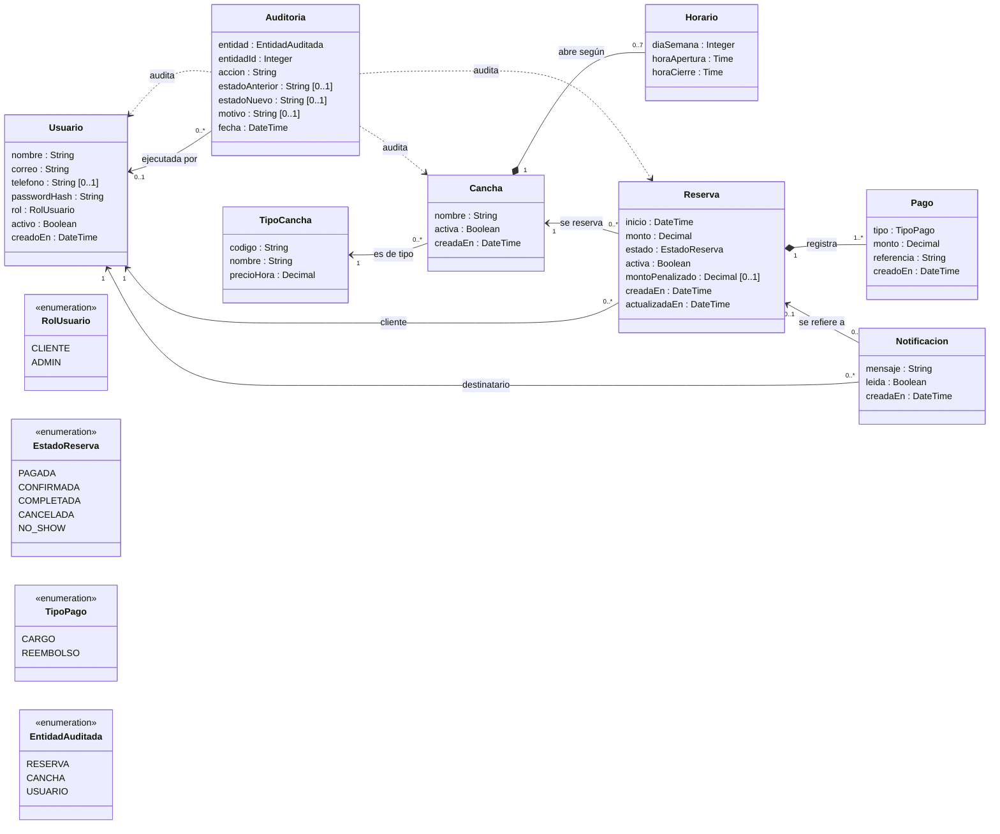

# Modelo de contenido

Diagrama de clases UWE corregido. Reemplaza al del Entregable 1 (E1 Cap. I, Modelo de Contenido) y aplica las correcciones de contenido de la sección 4.1 de `docs/trazabilidad.md` (filas MOD-CON.a a MOD-CON.f). Responde al issue #49.

La fuente de cada clase es `db/migrations/001_esquema.sql`: una clase por tabla, con los mismos nombres.

## 1. Convenciones

- **Atributos:** los nombres son los de las columnas, en minúscula inicial. No se dibujan los identificadores (`Id`) ni las claves foráneas: cada clave foránea es una asociación del diagrama.
- **Enumeraciones:** son las restricciones `CHECK` del esquema (`CK_Usuario_Rol`, `CK_Reserva_Estado`, `CK_Pago_Tipo` y `CK_Auditoria_Entidad`).
- **Sin operaciones:** las clases no llevan métodos. Las reglas están en la capa de servicio (`src/modules/*/*.service.js`), no en las entidades (MOD-CON.f).
- **Línea punteada:** referencia sin clave foránea. `Auditoria` guarda el tipo y el id de la entidad que cambió (`entidad` y `entidadId`).

## 2. Diagrama

Exportado para el informe: [`img/contenido.png`](img/contenido.png).

## 3. Clases

| Clase | Qué representa | Notas |
| --- | --- | --- |
| Usuario | Persona con cuenta en el sistema | Una sola clase para clientes y administradores; el rol los distingue. `correo` es único y se guarda en minúsculas |
| TipoCancha | Modalidad de cancha y su precio por hora | `codigo` es único; `precioHora` es mayor que 0 |
| Cancha | Cancha del complejo | `nombre` es único. `activa` en falso es la baja: la cancha no se borra |
| Horario | Apertura y cierre de una cancha en un día de la semana | Como máximo uno por cancha y día (`diaSemana` de 1 a 7). Un día sin horario es un día cerrado. Las horas son en punto |
| Reserva | Bloque de 1 h de una cancha reservado por un cliente | `monto` es el precio del tipo de cancha copiado al reservar. `activa` es falso solo en `CANCELADA`, y libera el bloque |
| Pago | Movimiento del pago simulado de una reserva | Toda reserva nace con un `CARGO`. Una cancelación con reembolso agrega un `REEMBOLSO` |
| Auditoria | Registro de un cambio sobre una reserva, una cancha o un usuario | Sin usuario cuando la acción es del sistema (no-show automático) |
| Notificacion | Aviso para un usuario | Puede referirse a una reserva |

## 4. Multiplicidades que no salen solo del esquema

- **Reserva y Pago (`1..*`):** el esquema no limita la cantidad de pagos. El servicio de reservas crea exactamente un `CARGO` al reservar y, como máximo, un `REEMBOLSO` al cancelar.
- **Cancha y Horario (`0..7`):** sale de la unicidad de cancha y día (`UQ_Horario_CanchaDia`) y del rango de `diaSemana`.

## 5. Cambios respecto del Entregable 1

| Corrección de 4.1 | Fila de la matriz | En este diagrama |
| --- | --- | --- |
| Usuario con `rol` y `telefono` en una sola tabla; sin `Administrador.cargo` | MOD-CON.a | Clase `Usuario` única con `rol` y `telefono`; sin subclases |
| `TipoCancha` nueva; Cancha sin `modalidad` ni `precioPorHora`; `estado` pasa a `activa` | MOD-CON.b | Clase `TipoCancha` con `codigo`, `nombre` y `precioHora`; `Cancha` con `activa` |
| Horario con `diaSemana`, `horaApertura` y `horaCierre` | MOD-CON.c | Clase `Horario`; sin `fecha`, `horaInicio`, `horaFin` ni `disponible` |
| Reserva con `inicio`, `monto`, `estado`, `activa` y `montoPenalizado`; asociada a Cancha y a Cliente | MOD-CON.d | Clase `Reserva` asociada a `Cancha` y a `Usuario`; sin asociación con `Horario` |
| Agregar `Pago`, `Auditoria` y `Notificacion` | MOD-CON.e | Las tres clases, con sus asociaciones con `Reserva` y `Usuario` |
| Sin métodos en las entidades | MOD-CON.f | Clases sin operaciones |
