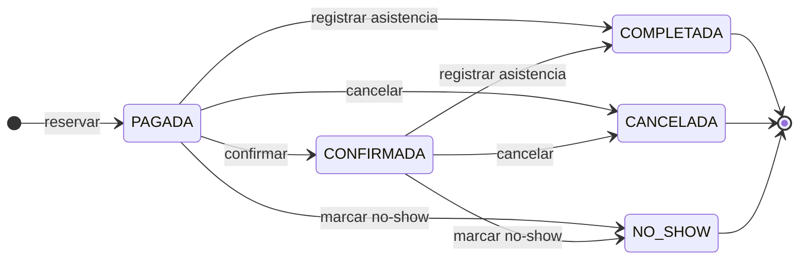

# Estados de la reserva

Diagrama de estados de la reserva. El modelo de procesos del Entregable 1 no lo tenía (fila MOD-EST.b de `docs/trazabilidad.md`, sección 4.1). Responde al issue #49.

La fuente es la tabla de transiciones de `src/modules/reservas/reglas.js` (`TRANSICIONES`), con las condiciones de `src/modules/reservas/reservas.service.js`.

## 1. Diagrama

Exportado para el informe: [`img/estados-reserva.png`](img/estados-reserva.png).

## 2. Estados

| Estado | Significado | Final |
| --- | --- | --- |
| `PAGADA` | La reserva se creó y se registró su pago simulado. Es el estado inicial: no existe un estado "pendiente" | No |
| `CONFIRMADA` | El administrador la confirmó | No |
| `COMPLETADA` | El administrador registró la asistencia del cliente | Sí |
| `CANCELADA` | La canceló el cliente o el administrador, o se canceló por la baja de la cancha. Libera el bloque | Sí |
| `NO_SHOW` | Pasó el bloque sin que se registrara la asistencia | Sí |

## 3. Transiciones

| Acción | Desde | Hacia | Quién | Condición | Efecto |
| --- | --- | --- | --- | --- | --- |
| Reservar | — | `PAGADA` | Cliente | Bloque libre, futuro, a 30 días como máximo y dentro del horario de la cancha | Pago `CARGO` por el monto |
| Confirmar | `PAGADA` | `CONFIRMADA` | Administrador | La reserva no empezó | — |
| Registrar asistencia | `PAGADA` o `CONFIRMADA` | `COMPLETADA` | Administrador | Desde 15 min antes del inicio hasta el fin del bloque | — |
| Cancelar | `PAGADA` o `CONFIRMADA` | `CANCELADA` | Cliente dueño de la reserva o administrador | La reserva no empezó | Con 24 h o más de anticipación: penalización de 0 % y reembolso total. Con menos de 24 h: penalización de 50 % y reembolso del resto. Pago `REEMBOLSO` |
| Cancelar por baja de cancha | `PAGADA` o `CONFIRMADA` | `CANCELADA` | Administrador, al dar de baja la cancha | Reservas de la cancha cuyo bloque no terminó | Sin penalización. Pago `REEMBOLSO` por el total |
| Marcar no-show | `PAGADA` o `CONFIRMADA` | `NO_SHOW` | Sistema | Pasó 1 h o más desde el inicio | Penalización de 100 %, sin reembolso |

Toda transición queda en `Auditoria` con el estado anterior y el nuevo, y genera una `Notificacion` para el cliente, en la misma transacción que el cambio de estado.

## 4. Notas

- **Asistencia sin confirmar:** `PAGADA` pasa a `COMPLETADA` sin pasar por `CONFIRMADA`. La confirmación del administrador no es requisito para registrar la asistencia.
- **No-show automático:** no hay una tarea programada. El sistema marca las reservas vencidas antes de cada operación que lee o cambia reservas, y antes de consultar la disponibilidad.
- **Estados finales:** `COMPLETADA`, `CANCELADA` y `NO_SHOW` no admiten ninguna acción. Un intento responde `TRANSICION_INVALIDA`.
