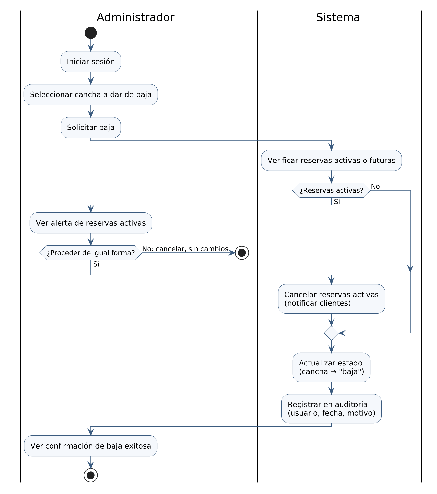

# Flujo de baja de cancha

Diagrama de actividad del flujo de baja de cancha, corregido. Reemplaza al del Entregable 1 (E1 Cap. I, Modelo de Procesos) y aplica la corrección de este flujo de la sección 4.1 de `docs/trazabilidad.md` (fila MOD-PRO-F2.a). Responde al issue #49.

## 1. Diagrama

Fuente PlantUML: [`flujo-baja-cancha.puml`](flujo-baja-cancha.puml).

- **Carriles:** Administrador y Sistema.
- **Sin reservas activas:** el Sistema pasa directo a actualizar el estado de la cancha.
- **Con reservas activas:** el Administrador ve la alerta y decide. Si no procede, el flujo termina sin cambios; si procede, el Sistema cancela las reservas activas notificando a los clientes y sigue con la actualización del estado.
- En los dos casos, el Sistema registra la baja en la auditoría y el Administrador ve la confirmación.

## 2. Cambios respecto del Entregable 1

| Corrección de 4.1 | Fila de la matriz | En este diagrama |
| --- | --- | --- |
| La rama "No" de "¿Reservas activas?" iba a "Cancelar reservas"; debe ir a "Actualizar estado". No se cambia el orden de las actividades | MOD-PRO-F2.a | La rama "No" va directo a «Actualizar estado (cancha → "baja")». Las actividades siguen en el mismo orden |
